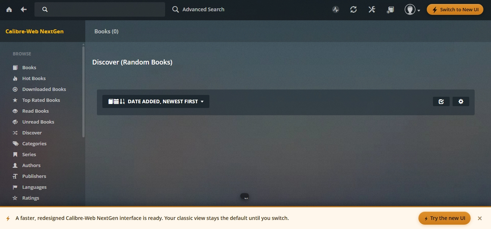

# Lab 5 — Dynamic Testing: Object-Level Authorization in Calibre-Web NextGen

> **Status:** In progress · Authorized local research only · No confirmed vulnerability or assigned CVE

## Project overview

In this lab, I am taking a potential object-level authorization issue from static analysis into a running application. My goal is to determine whether a non-administrator account can change the reading status of a book it is not allowed to see. I am testing only my own local instance, using synthetic books and accounts that I created for this research.

The core question is straightforward: **Does the server enforce book visibility rules when it receives a direct read-status request, or does it rely on the user interface to hide restricted books?**

## Research baseline

| Item | Baseline |
|---|---|
| Application | Calibre-Web NextGen |
| Source version | v4.1.43 |
| Git commit | `7e9221f455329bb3e6611b4652ac23b7f8629bb0` |
| Source branch | `main` |
| Test scope | Local Docker instance; synthetic content; controlled user accounts |
| Candidate | Read-status object authorization (`/ajax/toggleread/<book_id>`) |

## Walkthrough — what I did and why

### 1. Source-code baseline and reproducibility

I started by verifying that my local source checkout matched the code reviewed during static analysis. I checked for uncommitted changes, recorded the Git commit and branch, and read the repository VERSION file. This matters because security findings are only reproducible when the tested code is identified precisely.

**Commands / configuration I used**

```text
`git -C .\targets\Calibre-Web-NextGen status --short`
`git -C .\targets\Calibre-Web-NextGen rev-parse HEAD`
`git -C .\targets\Calibre-Web-NextGen branch --show-current`
`Get-Content .\targets\Calibre-Web-NextGen\VERSION`
```

**What I observed**

The checkout was reported clean on `main`, at commit `7e9221f455329bb3e6611b4652ac23b7f8629bb0`, with source version `4.1.43`. Searching `cps/constants.py` for `STABLE_VERSION` and recursively searching `cps` for the literal version did not locate it; the top-level VERSION file did.

<details>
<summary>Original screenshots for this stage (7)</summary>


</details>

### 2. Python runtime investigation

I first explored whether I could launch the target directly in my existing Python virtual environment. This gave me a clearer picture of the application’s dependencies before I chose a runtime.

**Commands / configuration I used**

```text
`.\.venv\Scripts\Activate.ps1`
`python .\targets\Calibre-Web-NextGen\cps.py --help`
`python -m pip install -e .\targets\Calibre-Web-NextGen`
```

**What I observed**

The direct launch failed because Flask was missing. The editable installation encountered native-package build problems, including `python-ldap` requiring Microsoft Visual C++ 14.0 or later. Source inspection showed LDAP imports are handled as optional at runtime, but the overall dependency set remained difficult to reproduce on Windows. A separately installed `faust-cchardet` version did not match the target’s declared version constraint. I did not treat this failed bare-metal setup as an application vulnerability.

<details>
<summary>Original screenshots for this stage (20)</summary>


</details>

### 3. Choosing the supported container runtime

I checked the project’s own setup documentation and selected Docker Desktop with WSL2 for Windows. This was a way to run the application closer to its documented environment without modifying the target source code or forcing incompatible Python dependencies.

**Commands / configuration I used**

```text
`wsl --status`
`wsl --list --verbose`
`docker info --format "Docker Root Dir: {{.DockerRootDir}} | Server Version: {{.ServerVersion}}"`
```

**What I observed**

WSL2 was available; Ubuntu was installed, followed by Docker Desktop. I initially configured Docker storage on an external D: drive. That original storage choice is part of the historical setup and was later changed during recovery.

<details>
<summary>Original screenshots for this stage (13)</summary>


</details>

### 4. Creating an isolated Lab 5 deployment

I inspected the repository’s Compose file and made a separate Lab 5 copy rather than editing the upstream file. I checked volume paths, validated the Compose configuration, and started the application. Keeping the lab isolated helps protect the original source checkout and separates test data from personal files.

**Commands / configuration I used**

```text
`Copy-Item .\targets\Calibre-Web-NextGen\docker-compose.yml .\docker-compose-lab5.yml`
`docker compose -f .\docker-compose-lab5.yml config --quiet`
`docker compose -f .\docker-compose-lab5.yml up -d`
`docker compose -f .\docker-compose-lab5.yml ps`
```

**What I observed**

The original deployment pulled the `latest` image and started on host port `8083`. Docker reported the container as healthy. The original bind-mounted test directories were on D:, and that arrangement was superseded during recovery. The `latest` tag alone does not prove which version was running at that time.

<details>
<summary>Original screenshots for this stage (9)</summary>


</details>

### 5. Initial application baseline

I opened the local web interface, located the documented default administrator credentials in the project source, and confirmed I could reach the authenticated library. I also checked the on-disk library state before importing any test material.

**Commands / configuration I used**

```text
`http://localhost:8083` (original deployment)
`docker compose -f .\docker-compose-lab5.yml logs`
```

**What I observed**

The application loaded successfully and initially showed zero books. The library directory contained Calibre metadata database files but no imported book objects. Default credentials are not included in this public write-up as reusable secrets.

<details>
<summary>Original screenshots for this stage (5)</summary>





</details>

### 6. Building the controlled authorization dataset

I created two synthetic, non-copyrighted test books and a non-administrator user. I kept one book accessible and applied a deny-tag rule to the second book. This produced a clear authorization boundary for testing whether a direct object-ID request could reach an object hidden from the user.

**Commands / configuration I used**

```text
Original ingest method: write synthetic TXT files to the dedicated ingest directory; the application converts them to EPUB.
Test account: `lab5-user-a` (non-admin; eBook viewer permission only).
Deny tag: `lab5-restricted`.
```

**What I observed**

The original environment displayed two books. In that environment, the permitted book was ID `2`, and the restricted book was ID `3`. The second book had the `lab5-restricted` tag, and the test user had a matching deny-tag restriction. These IDs were specific to the original database and **must be rechecked** after recovery.

<details>
<summary>Original screenshots for this stage (15)</summary>


</details>

### 7. Confirming the normal visibility boundary

I signed out of the administrator account and logged in as the low-privilege test user. Before manipulating any requests, I checked what that user could see through the normal application interface. This was essential control evidence: without a confirmed visibility restriction, a later direct request would not demonstrate an authorization boundary.

**Commands / configuration I used**

```text
Open the Books page as the restricted test user; compare with the administrator’s view.
```

**What I observed**

The original restricted account showed only the permitted book. The denied book was absent from its normal library view. This establishes UI visibility behavior; it does not, by itself, prove that every server endpoint enforces the same rule.

<details>
<summary>Original screenshots for this stage (2)</summary>


</details>

### 8. Capturing the authorized read-status request

I opened the permitted book and used Microsoft Edge DevTools to record the application’s normal read-status action. I inspected the Network entry to identify the method, endpoint, response, and form data that a valid request requires.

**Commands / configuration I used**

```text
`POST /ajax/toggleread/2` (original database)
Original local origin: `http://localhost:8083`
```

**What I observed**

The original control request returned HTTP `200 OK`. Its request included a CSRF token and XHR-related headers. This is the reference request for a controlled one-variable comparison.

<details>
<summary>Original screenshots for this stage (6)</summary>


)


</details>

### 9. Attempting the restricted-object request

I tried to reproduce the authorized action against the restricted book by changing the object ID while retaining the same user session. My first attempt used Edge’s Edit and Resend feature, but it failed at the browser tooling layer. I then tried a browser-console fetch request to determine whether the server could be reached.

**Commands / configuration I used**

```text
Original intended comparison: `POST /ajax/toggleread/2` → `POST /ajax/toggleread/3`
```

**What I observed**

The Edit and Resend attempt showed `FETCH_ERROR`, so it was not valid evidence of a server-side authorization decision. A later bare `fetch` reached the application but returned HTTP `400`; server logs identified a missing CSRF token. This 400 was a request-validity failure, not evidence that object-level authorization succeeded.

<details>
<summary>Original screenshots for this stage (7)</summary>


</details>

### 10. Troubleshooting request equivalence and CSRF

I inspected the legitimate request payload and headers so that a replay would reproduce the normal browser request as closely as possible. I investigated CSRF form data, token freshness, `X-CSRFToken`, `X-Requested-With`, and `Content-Type` rather than treating every HTTP 400 as a security finding.

**Commands / configuration I used**

```text
Observed legitimate content type: `application/x-www-form-urlencoded; charset=UTF-8`
Observed XHR header: `X-Requested-With: XMLHttpRequest`
Observed endpoint pattern: `/ajax/toggleread/<book_id>`
```

**What I observed**

Several manipulated requests returned HTTP `400`, including attempts with stale or incorrectly constructed CSRF data. A final closer-format request was prepared, but the provided documentation does not establish a verified server-side change to the restricted book. **Candidate #1 remains unconfirmed.**

<details>
<summary>Original screenshots for this stage (20)</summary>


)


</details>

## Environment recovery — October 2026

After the initial authorization testing, Docker storage failures interrupted the lab. I did not interpret these infrastructure failures as evidence about the target application. Instead, I recovered Docker Desktop and re-established a version-controlled testing environment.

The earlier deployment used storage on an external D: drive. For the rebuilt environment, I configured Docker Desktop’s WSL storage on the E: drive and preserved the previous data folders rather than deleting them. The recovery required correcting a stale Docker Desktop storage path, initializing a fresh Docker backend, and creating fresh Compose-managed volumes.

I also discovered that the newly pulled `latest` image was **v4.1.47**, while my Lab 4 source baseline was **v4.1.43**. I downloaded the `v4.1.43` image explicitly and updated the Lab 5 Compose file to pin that version. Before switching, I saved a backup of the newer configuration volume and configured a separate `lab5-config-4143` volume so the older application would not directly reuse a database initialized by v4.1.47.

I changed the host-side port mapping to `8600:8083` because the previous host port was unavailable. I validated the Compose configuration and recreated the container. The final Docker status showed the v4.1.43 container running as **healthy**. I then opened the application at `http://localhost:8600`, logged in as administrator, changed the default administrator password, and confirmed that the new library was empty.

**Recovery verification commands**

```powershell
docker compose -f .\docker-compose-lab5.yml config --quiet
docker compose -f .\docker-compose-lab5.yml up -d --force-recreate
docker ps --filter "name=calibre-web-nextgen"
```

**Verified recovery state**

| Property | Rebuilt lab |
|---|---|
| Docker image | `ghcr.io/new-usemame/calibre-web-nextgen:v4.1.43` |
| Local URL | `http://localhost:8600` |
| Container status | `healthy` |
| Dedicated configuration volume | `lab5-config-4143` |
| Library | Empty; test books need recreation |
| Administrator access | Verified; default password changed |

> **Evidence note:** The earlier screenshots above belong to the original deployment on port 8083. They should not be presented as screenshots of the rebuilt environment on port 8600. The rebuild has been verified through command output; new screenshots will be captured as testing resumes.

## Next phase — repeatable authorization test

I will recreate the two synthetic books and the restricted account in the rebuilt v4.1.43 environment. I will record the **new book IDs** rather than assuming they are still 2 and 3. Before sending any manipulated request, I will verify that the restricted user can see the allowed book and cannot see the denied book.

Then I will capture a fresh authorized read-status request, reproduce its required headers and CSRF form data, and change only the target book ID for the restricted-object test. Finally, I will verify the result independently through server logs and persistent application state.

| Test | Expected evidence |
|---|---|
| Normal visibility | Allowed book visible; denied book hidden |
| Authorized control | Read-status request succeeds for allowed book |
| Restricted-object request | Exact HTTP status and response, with valid request formatting |
| Independent verification | Confirm whether the denied book’s server-side reading status changed |

**Interpretation rule:** A 200 response alone is not proof of an authorization vulnerability, and a 400 response alone is not proof that authorization is enforced. I will report a finding only if the request is valid and the observed server-side behavior demonstrates an unauthorized effect.

## Conclusion so far

This project has taught me to separate three different kinds of problems: environment setup failures, request-construction failures, and actual application security failures. I established a legitimate read-status control and a restricted-book visibility boundary in the original environment, but the available evidence does not yet confirm an object-level authorization bypass. The next phase is a clean, reproducible retest on v4.1.43.

---

*All testing is performed against an isolated local installation with synthetic data. No real users, third-party systems, or production content are involved.*
